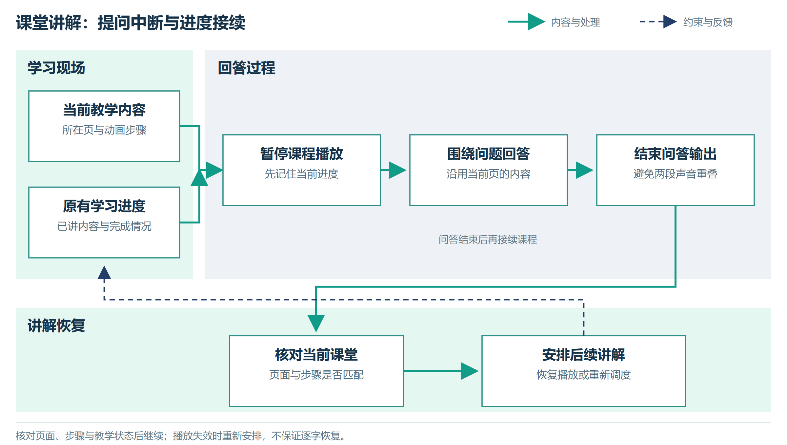
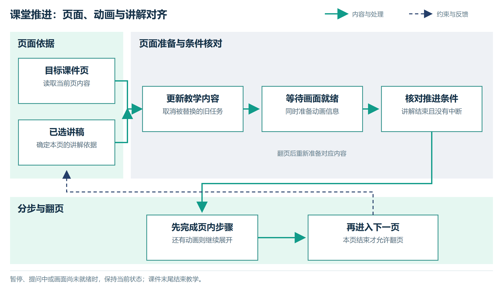
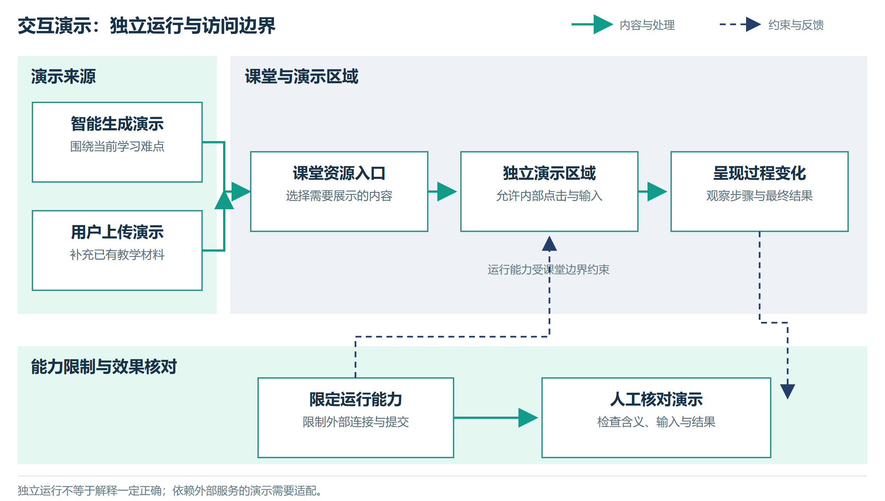
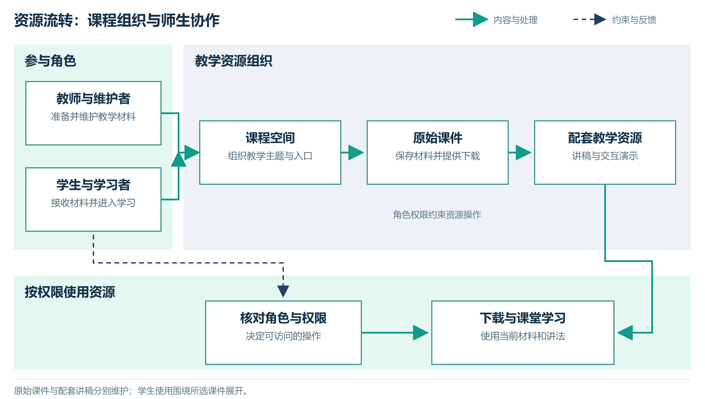
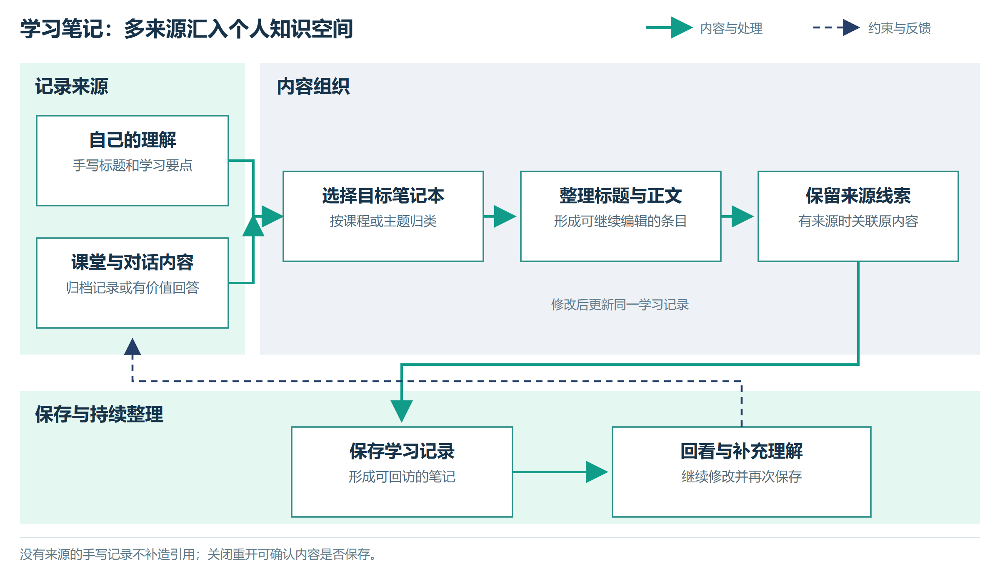
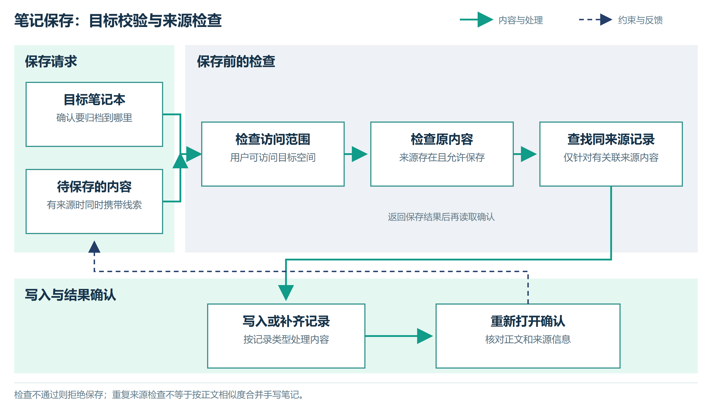

# 技术配图预览

HTML 展示使用 PNG 图片；SVG 保留为可编辑原图。两个版本内容一致。

[返回模拟课堂](../../../classroom-showcase.html) · [返回学习笔记](../../../notes-showcase.html)

## 提问可以随时插入，讲解有序接续

[可编辑 SVG 原图](classroom-interruption.svg)

## 页面、动画与语音，按同一教学节奏推进

[可编辑 SVG 原图](classroom-page-gate.svg)

## 交互 Demo 独立运行，课堂保持清晰边界

[可编辑 SVG 原图](classroom-demo-boundary.svg)

## 教师准备资源，学生沿课程进入学习

[可编辑 SVG 原图](classroom-resource-lanes.svg)

## 把零散学习内容，整理成可复用的笔记

[可编辑 SVG 原图](notes-record-anatomy.svg)

## 先确认能保存，再把内容放进正确的位置

[可编辑 SVG 原图](notes-save-protocol.svg)
